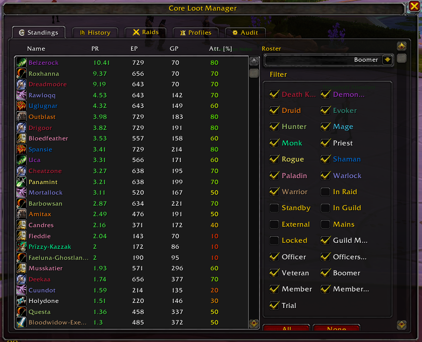

# UI overhaul: one window, settings as tabs

- **Status:** planned. All decisions made 2026-10-16 (column *Your call*; ✅ = as recommended)
- **Target version:** v1.0

## Problem

BP EPGP has two places where you manage things:

1. **The main window.** Open it from the minimap button or `/clm`. It has the Standings, History, Raids, Profiles and Audit tabs, where you award EP, decay, create raids and so on.
2. **Options → AddOns → Core Loot Manager.** This is the Blizzard settings panel, with a *Core Loot Manager* page (personal settings) and a *Rosters* sub-page (guild EPGP settings). The minimap right-click menu item "Configuration" opens this panel too.

Officers have to jump between the two. The Blizzard panel is also cramped and slow to navigate.

## Proposal

Remove the Options → AddOns pages **completely** (no stub page). Move whatever settings we keep into **new tabs in the main window**, next to Standings / History / Raids / Profiles / Audit. Make the window wider so all tabs fit on one row.

### Main window today

*(screenshot: Standings tab, 5 tabs, roster dropdown + class/rank filter sidebar)*

- **Fixed size:** the frame is fixed at **700 × 572** (`UnifiedGUI.lua:289-290`). The 5 tabs use most of the width. AceGUI's `TabGroup` wraps to a second row when tabs don't fit, which looks messy, so more tabs means a wider frame.
- **Every tab is a table plus a sidebar:** `RegisterTab` requires a table structure and a data feeder (`UnifiedGUI.lua:340-363`). A settings tab has no table, so `UnifiedGUI` needs a second tab kind, *page*, that fills the whole tab area with hand-built widgets (D5).
- **Leftovers from removed features:** visible in the screenshot and going away with the v1 plan:
  - the **Att. [%]** column (attendance tracker);
  - the **Standby**, **External**, **Mains** and **Locked** filters (bench, cross-guild, alt-main linking, profile locking);
  - the **Roster** dropdown (single roster).

### Proposed tab bar

| Standings | History | Raids | Profiles | Audit | **Settings** | **Guild settings** | **Gear values** | **Advanced** |
|---|---|---|---|---|---|---|---|---|
| existing | existing | existing | existing | existing | new: *My settings* (Part 2) | new: Part 3 except gear values | new: default slot values + item overrides | new: logging; *Remove roster* (officers only) |

- **Width:** 9 tabs need roughly **1050 px** instead of 700 to stay on one row. The final number gets tuned in-game.
- **Wider tables:** the extra width also helps the existing tabs: wider Name and History columns, so names like "Faeluna-Ghostlan…" stop being cut off.
- **Resizable (D9):** the frame can be resized down to a minimum size that still fits the tab bar on one row. Its size is stored per character, like its position is stored today (`UnifiedGUI.lua` `StoreLocation`). Tables and pages must reflow on resize.
- **Visibility (D3):** everyone sees all tabs. On Guild settings, Gear values and the officer parts of Advanced, controls are read-only unless you're an officer.

## How it works today

Knowing this explains the decisions below:

- **Panel registration:** `Modules/Common/ConfigManager/ConfigManager.lua:40-48` registers each config group with `AceConfigDialog:AddToBlizOptions`. Modules add options with `ConfigManager:Register(group, options)`.
- **Two kinds of settings:**
  - **Personal settings** (group `GLOBAL`). Stored per character in SavedVariables, only affect you, and anyone can change them.
  - **Guild settings** (group `ROSTER`, built in `Modules/Rosters/RosterManager/Options.lua`). Every change is a **ledger entry**: it syncs to everyone, and only officers can change it ("Is Officer" ranks, see [sync-and-security.md](../sync-and-security.md) S1/S2).
- **Cheap path, not taken:** `AceConfigDialog:Open(appName, container)` could render the existing option tables inside a tab. We chose to **hand-build** the pages instead (D5): more work, but full control over layout. The getters/setters in the existing option tables (e.g. `Options.lua` `GetRosterOption`/`SetRosterOption`, `GlobalConfigs`) can still be reused as the data layer behind the new widgets.

---

## Part 1: design decisions

| # | Question | Options | Recommendation | Your call |
|---|---|---|---|---|
| D1 | When? | a) part of v1.0 · b) v1.1 | a | **a: v1.0** ✅ |
| D2 | What happens to Options → AddOns? | a) remove completely · b) keep a one-line stub page | b | **a: remove completely** |
| D3 | Who sees the Guild settings / Gear values tabs? | a) everyone; read-only unless officer · b) officers only | a | **a: everyone, read-only** ✅ |
| D4 | Where do settings go? | a) one Configuration tab with sub-tabs · b) separate top-level tabs in a wider window | a | **b: top-level tabs** |
| D5 | How to build the settings pages | a) render existing AceConfig tables · b) hand-build widgets | a | **b: hand-build** |
| D6 | Minimap right-click "Configuration" | a) open the Settings tab · b) remove the menu item | a | **b: remove** (`/bpepgp config` still opens the Settings tab) |
| D7 | Roster creation (single roster) | a) "Set up BP EPGP" button for officers when no roster exists · b) "Create roster" button in Guild settings | a | **a: setup button** ✅ |
| D8 | "Advanced" items (logging, remove roster) | a) bottom of Settings tab · b) own *Advanced* tab | a | **b: own Advanced tab** (9 tabs) |
| D9 | Window size | a) fixed, wider · b) resizable with minimum size, remembered per character | b | **b: resizable** ✅ |

---

## Part 2: personal settings → **Settings** tab (`GLOBAL` group, stored per character)

Legend for **Your call**: **K** = keep (move to a settings tab) · **F** = fix: no setting, hard-code the value shown in the recommendation · **D** = drop the feature.

### General

| Setting | What it does | Recommendation | Your call |
|---|---|---|---|
| UI scale | Rescales all windows except the bidding window | K | ✅ |
| Bindings (button) | Opens the WoW keybinding screen | D. Keybinds still appear under the addon in WoW's own Keybindings menu | ✅ |
| Addon sounds | Plays sounds on auction start/end | K | ✅ |
| Toggle minimap icon | Shows/hides the minimap button | K, plus a slash command to bring it back | ✅ |
| Wipe events | Deletes the local ledger and resyncs from others | K, under *Advanced* | **D** |
| Logging level / Verbose / Wipe logs | Debug logging for bug reports | K, under *Advanced* | **K**, in the Advanced tab ✅ |
| Disable data synchronisation ("Danger Zone") | Stops sync entirely | D | ✅ |
| Logo, "Created by Lantis", Patreon, Discord link | CLM branding | D, replaced by a small *About* line with the CLM credit (release plan §8) | ✅ |

### Raid warnings (officers)

| Setting | What it does | Recommendation | Your call |
|---|---|---|---|
| Raid start/end | Raid warning when a raid starts or ends | K | ✅ |
| Auction start/end | Raid warning when an auction starts or ends | K | ✅ |
| Auction end countdown | 5-4-3-2-1 raid warnings | K | ✅ |
| Loot awards | Raid warning "X wins Y for N GP" | K | ✅ |
| Announce award to Guild | Also posts the award in guild chat | D. The raid warning is enough | ✅ |
| Announce loot from corpse to raid (+ "only when ML/RL", + rarity) | Lists the items in your loot window in raid chat | D. With personal loot this only lists your own drops | ✅ |

### Bidding window (raiders)

| Setting | What it does | Recommendation | Your call |
|---|---|---|---|
| Auto-open bidding window | Opens the window when an auction starts | K | ✅ |
| Close on bid | Closes the window after you bid | K | ✅ |
| Advance to next item after bid | Multi-item auctions: jumps to the next item | K | ✅ |
| Ignore unusable items | Skips items your class can't use | K | ✅ |
| Hide in combat | Hides the window in combat | K | ✅ |
| Include passes / Include cancels | Shows passes/cancels in the bid list | F: on | ✅ |
| Timer bar width / height | Size of the countdown bar | K | ✅ |
| Timer bar font / font size / texture | Uses LibSharedMedia pickers | F: fixed font and texture. This lets us drop `LibSharedMedia-3.0` and `AceGUI-3.0-SharedMediaWidgets` if nothing else uses them | ✅ |
| Toggle test bar / Restore bar defaults | Preview and reset for the bar | D, if the above is fixed. Otherwise K | ✅ |

### Auctioning (officers)

| Setting | What it does | Recommendation | Your call |
|---|---|---|---|
| Auction modifier combination | Which modifier + click opens the auction window (default Alt) | K. Must differ from the award modifier (release plan §5.2 bug) | ✅ |
| Award modifier combination | Which modifier + click opens the award window | K | ✅ |
| Remove on award | Removes an item from the auction list once awarded | F: on | ✅ |
| Remove items without bids | Removes items nobody bid on after the auction | K | ✅ |
| Auto-trade after award | Opens trade with the winner when possible | K (trade helper) | ✅ |
| Include passes / Include cancels | Shows passes/cancels in the auction bid list | F: on | ✅ |
| Post all bids on award | Posts the full bid list to chat when awarding | K | ✅ |
| Fill auction list from corpse | Adds items from your loot window to the auction list | K | ✅ |
| Fill auction list with looted items | Adds items you receive to the auction list | K | ✅ |
| Loot rarity threshold | Minimum quality for the two fill options | K | ✅ |
| Ignore (item classes) | Item types never added to the auction list | K | ✅ |
| Store bids (auction history) | Saves all bids in auction history | F: on | ✅ |
| Post channel (auction history) | Where "post bids" sends to | K | ✅ |
| Master Loot Only / Group Loot Only | Sub-options of the fill toggles | D. Retail raids have no master or group loot | ✅ |

---

## Part 3: guild settings → **Guild settings** + **Gear values** tabs (`ROSTER` group, synced ledger entries, officers only)

### Roster

| Setting | What it does | Recommendation | Your call |
|---|---|---|---|
| Create roster (name + point type) | Creates a roster | D. Replaced by the D7 setup button | ✅ |
| Roster name | Renames the roster | F: "BP EPGP" (or K if you want a custom name) | ✅ |
| Copy settings / Copy source | Copies settings from another roster | D (single roster) | ✅ |
| Remove roster | Deletes the roster | D, or keep under *Advanced* as a "reset everything" option | **K**, in the Advanced tab, officers only |
| Point type (read-only) | Shows DKP/EPGP | D (always EPGP) | ✅ |

### EPGP

| Setting | What it does | Recommendation | Your call |
|---|---|---|---|
| Starting EP / Starting GP | Values for a newly added player | K | ✅ |
| Minimum GP | GP floor (PR = EP / GP) | K | ✅ |
| Rounding (decimals) | Rounding of EP/GP values | K | ✅ |
| PR rounding | Rounding of displayed PR | K | ✅ |
| On-time bonus (toggle + value) | EP given at raid start | K | ✅ |

### Auction rules

| Setting | What it does | Recommendation | Your call |
|---|---|---|---|
| Tier button names (Base, Small, Medium, Large, Max) | Text on the raiders' bid buttons | K | ✅ |
| Minimum standing | Minimum EP needed to bid | K | ✅ |
| OS | Shows an Off-spec button | K | ✅ |
| Auction length | Seconds per auction | K | ✅ |
| Anti-snipe time | Extends the auction if someone bids at the end | K | ✅ |
| Multiply time | Auction time × number of items | K | ✅ |
| Roll time | Length of the `/roll` phase | K | ✅ |
| Auction type | Open/Sealed/Vickrey/Anonymous | F: Open | ✅ |
| Item value mode | Single-priced / Ascending / Tiered | F: Tiered | ✅ |
| Use named buttons | Named buttons instead of numbers | F: on | ✅ |
| Always allow cancel/pass | Affects ascending mode only | F (no setting needed) | ✅ |

### Gear values (own tab)

| Setting | What it does | Recommendation | Your call |
|---|---|---|---|
| Default slot values | GP per gear slot × 5 tiers | K. This is the core GP table | ✅ |
| Item value overrides | Per-item GP values (auto-written on auction start); view/remove | K | ✅ |

---

## Already removed by the v1.0 plan

These settings disappear with features the release plan already removes. **Confirmed: all stay removed.**

| Setting(s) | Removed with |
|---|---|
| Boss kill bonus (+ default value, per-boss values sub-page), raid completion bonus, interval bonus (time, value), include bench, online only, same zone only | Boss-kill / interval / raid-end bonuses |
| Weekly reset timezone, weekly cap, hard cap | DKP point caps |
| Allow subscription, auto bench leavers, bench multiplier | Bench / standby |
| Zero-sum bank, inflation value, tax, allow bidding over standings, minimal increment, always allow base / all-in / equal / 0 bids, auto-update bid values, "new highest bid" raid warning | DKP + Ascending bidding |
| Dynamic item values (toggle + equation sub-page) | Dynamic item values |
| Award multipliers (per class) | Class award multipliers |
| Disenchanters list, disenchant removed items | Disenchant |
| Auto-assign from corpse | Master loot |
| Display price on tooltip, "Select rosters to display" | Item tooltip GP prices |
| Roll on loot + 6 include toggles (legendary, stacking, patterns, mounts, toys, cosmetics) | Auto-roll (GlobalUIHandlers) |
| Attendance: raids needed in reset, average weeks | Attendance tracker |
| Never show changelog, toggle changelog | Changelog module |
| No fun allowed | April Fools |
| Integrations, Tracker and Cross-guild sync pages | Those addons/modules |

## Other consequences

- **Raids tab sidebar** (`UnifiedGUI_Raids.lua:80-137`) shows the bonus settings when creating a raid. After the change it only needs the on-time bonus, and it can link to the Guild settings tab instead of duplicating it.
- **Profiles tab** loses the alt-main linking button (already planned).
- **Slash commands** registered via `ConfigManager:RegisterSlash` are commands, not settings, so they're unaffected. Only the `/bpepgp` root needs a `config` subcommand that opens the Settings tab.
- **`ConfigManager`** shrinks: no `AddToBlizOptions` at all, and no `AddGroup` for the Integrations/Tracker/Cross-guild pages.
- **Settings changes while an auction runs:** guild settings are ledger entries and apply after sync. That's the same as today.

## Part 4: later, further visual redesign

The hand-built settings pages (D5) are a first step. Once everything is in one window, we can restyle the rest. Options: keep AceGUI but clean up the layout; a raider-first compact bidding window; an officer "raid dashboard"; or native Blizzard frames (`ScrollBox`/`DataProvider`) to drop AceGUI. We'll decide later.
